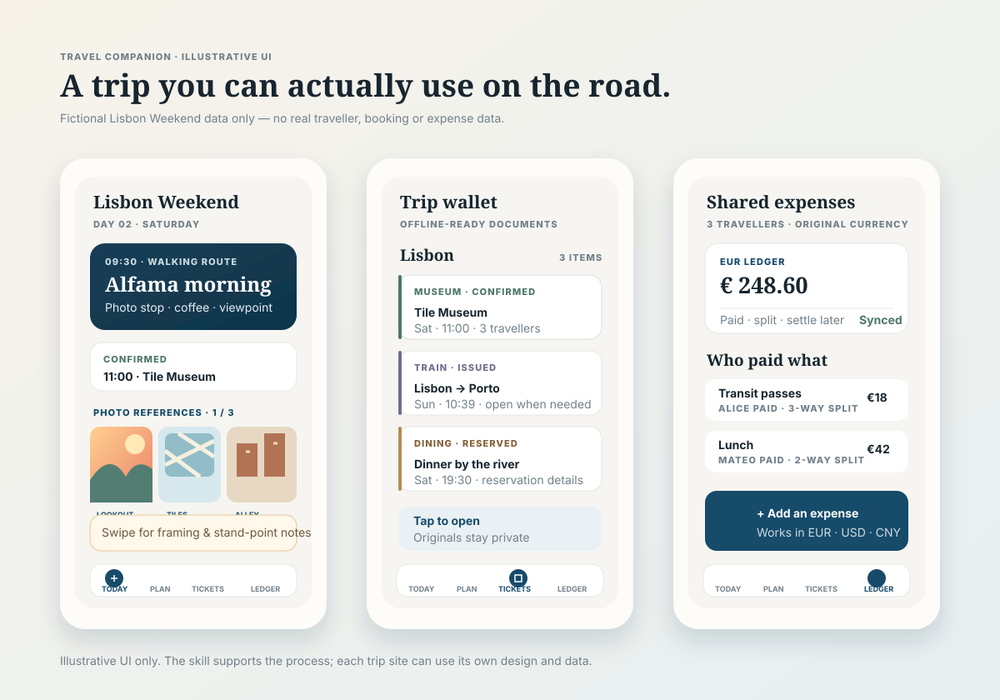

# Travel Companion

An open Codex skill for planning real-world, multi-day trips—from research and booking checks to a practical mobile itinerary, safety notes, photo references, and shared expense settlement.

中文：一个面向真实多日旅行的 Codex skill，覆盖行程研究、预约核对、手机旅行助手、安全提醒、拍照参考和共同记账结算。

## What the result can look like



_Illustrative UI using fictional data; it is not a real trip or a live product screenshot._

## What it helps with

- Research places, transport, restaurants, tickets, opening hours, and practical travel constraints.
- Turn scattered notes and reservations into a phone-friendly, day-by-day plan.
- Keep confirmed plans distinct from backups and retain the reason when a plan changes.
- Organize photo references, safety guidance, arrival notes, lodging, luggage and offline access.
- Design a shared travel ledger with clear currencies, split rules and settlement results.

## Install in Codex

```bash
git clone https://github.com/ianc1225/codex-travel-companion.git
mkdir -p ~/.agents/skills
cp -R codex-travel-companion/travel-companion ~/.agents/skills/
```

Restart Codex, then invoke `$travel-companion`.

## Example prompt

```text
Use $travel-companion to plan a 10-day Japan Kansai trip for three people. Research the itinerary first, verify reservations and transport, then build a mobile-friendly travel assistant with photo references, safety notes, and a shared expense ledger.
```

## Privacy

This repository contains reusable workflow instructions only. It does **not** include real addresses, tickets, reservation codes, passwords, expense data, private photos or a completed person's trip plan.

## Contributing

Issues and pull requests are welcome. Please do not contribute personal trip data or credentials.

## License

[MIT License](LICENSE)
